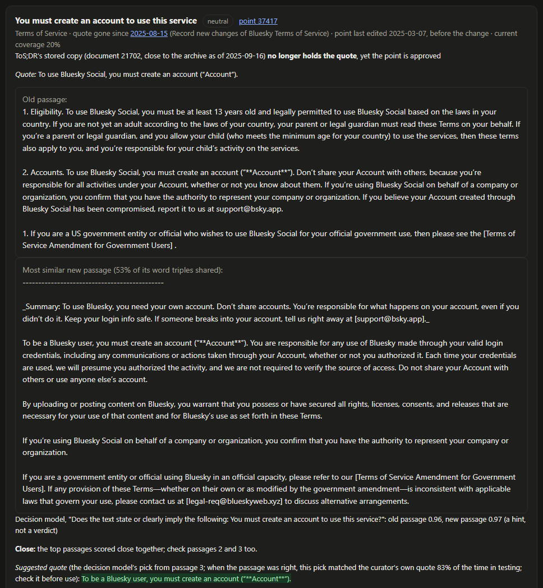

# policywatch

**679 approved ToS;DR points quote text that the platform has since edited out of its terms or privacy policy (483
fully, 196 in part). For 656 of them, ToS;DR's own stored copy still holds the old text.**

[ToS;DR](https://tosdr.org)'s volunteer curators rate online services from "points": a case ("You waive your right
to a class action") backed by a quote from the service's terms. [Open Terms Archive](https://opentermsarchive.org)
records every version of those documents. policywatch compares the two, lists the points whose evidence is gone, and
suggests to a curator where each case is stated now. It runs on a desktop CPU with no API key.

- **Found.** 5,658 approved, quoted points on 186 services were checked against every archived version.
  - 679 points (on 87 services) lost their quote in an edit by the platform itself: 483 fully and 196 in part.
    39 of them are "date of the last update" points, whose quote is the date line.
  - For 656, ToS;DR's stored copy still holds the quote.
  - A blind audit (an LLM rater) judged 27 of 30 sampled drops on other services' documents (contrib), and 8 of 10
    on the 20 platforms, to be real edits.
- **Suggested.** Where is the case stated now?
  - Kev-4B, a 4B decision model, ranks the curator's own passage first 62-75% of the time in three pre-registered
    samples. BM25 and embedding search manage 30-43%.
  - Kev-4B is a LoRA adapter and a head on a frozen Qwen3.5-4B-Base. It returns p(yes) for many yes/no questions
    about one passage in one request.
- **The control that changed the claim.**
  - Kev's base model family (Qwen3.5-4B, the instruct release; Kev's own base checkpoint was never run), prompted
    with the same yes/no question, did as well wherever it was run.
  - The decision-model endpoint took 1.9-5.4x less time per question than the instruct model asked one question
    per request. Asked all of a passage's questions in one prompt, the instruct model took 1.79 s per question
    against Kev's 2.01 s, with no difference in accuracy (pre-registered, 2,043 questions). That is one run per arm
    with the servers set up differently, so it shows no cost difference, not that either is cheaper.
  - So nothing measured here comes from the decision model. policywatch's results are those of a 4B LLM reading
    each passage.
- **Limits.**
  - No person has rated a suggestion: every rater is a Claude or GPT model.
  - A much cheaper cross-encoder reranker was beaten in only one of three relocation samples.
  - The first design, a meaning-diff scanner, failed its pre-registered tests. Its results are kept in
    [SCANNER.md](SCANNER.md).

[Results in detail](RESULTS.md) · [Plans, results and rater cards](stale/) · [Running it](RUN.md)

*One card from the curator page (2026-11-15 build). The quote is gone from Bluesky's current terms and from
ToS;DR's stored copy. The card shows the old passage, the closest new one, Kev-4B's scores and the suggested
sentence; the top 3 passages follow, folded.*

## Parts
- **Stale evidence finder** (`stale/`, string matching, no model). It covers the 20 large platforms of Open Terms
  Archive's pga-versions collection and four more collections (contrib, genai-contrib, dating, user-rights).
  - It writes a curator page and CSV per collection.
  - It writes a re-crawl priority list: 10 ToS;DR documents hold 257 of the 656 points.
  - It has a daily watch, built but not scheduled. Its 2026-11-15 run found Pinterest's rewrite (effective 12
    November): 8 points lost their quote.
- **Where the case is stated now** (Kev-4B). The page shows the top 3 passages of the current text for each stale
  point and a sentence to quote. A suggestion is marked "Clear" when its top passage leads clearly; Clear
  suggestions were right 50 times in 53 in a held-out test.
- **Missing points** (Kev-4B behind a reranker shortlist). It suggests cases that a document states but ToS;DR has
  no point for on that service. It covers the 40 privacy policies and terms of the 20 platforms, and 20 documents of other services drawn at
  random. ToS;DR's own
  [DocBot](https://github.com/tosdr/DocBot) also suggests points to curators; the two were not compared.
- **Meaning-diff scanner** (`policywatch/`, the original goal). It asks a fixed bank of questions about the old and
  new text of every update. It failed: see [SCANNER.md](SCANNER.md).
- **AI-training clause watch** (`aiwatch/`). It replays the archive from 2023 to November 2026 and flags changes that
  newly let a company train AI on its users' content or data. Two arms: a keyword rule and Kev-4B.
  - Kill test (pre-registered): on 14 publicly reported incidents both arms flag the same 10. Kev raises 2.3 times
    the alerts. Reading: "keyword ties: stopped" ([RESULT_aiwatch.md](aiwatch/RESULT_aiwatch.md)).
  - Ledger (exploratory): two AI raters label every alert. The keyword rule is right about half the time and finds
    about half of the grants. Kev's own alerts are being rated ([RESULT_ledger.md](aiwatch/RESULT_ledger.md)).

## Main results
| Question | Answer | Numbers |
|---|---|---|
| Are the listed drops real platform edits? (blind audit, an LLM rater) | **Mostly** | 27 of 30 sampled contrib drops; 8 of 10 on the 20 platforms. |
| Where is a case stated now? Gold is the curators' own quotes; 602 points in three pre-registered samples. | **Kev-4B ahead of BM25 and bge** | Kev 62% / 75% / 62.5%; BM25 36 / 41 / 34.5; bge-small 30 / 43 / 34. |
| Kev against its base family (the instruct model, same question) | **No difference shown** | 62 vs 60 and 75 vs 74; "states the case" .73 vs .73; missing-points AUROC .721 vs .715. |
| Kev against a cross-encoder reranker (bge-reranker-v2-m3) | **Not shown to beat it on curator quotes** (1 of 3 samples) | On LLM-rated "states the case", Kev .73 vs .61. The reranker is 3.6-5x cheaper. |
| Missing-point suggestions on 28 documents: the page against the reranker's own top 10 (blind LLM raters) | **Page better** | 190 of 280 rated YES (.68) vs 150; +.14 [+.075, +.21], resampling documents; GPT as second rater 203 vs 150. |
| The same on 20 documents of 20 other services, drawn at random before any model ran; and the printed p(yes) as a label | **Page better; label adopted** | 139 of 200 vs 99 (+.20 [+.14, +.27]); suggestions printed at p(yes) 0.90 or more: 114 of 133 rated YES, the rest 25 of 67; GPT as second rater 144 vs 106. |
| Cost of the decision-model endpoint against the instruct model asked one question per request (idle CPU, 60 passages) | **Cheaper from 2 questions per passage** (against one question per request) | 0.83x at 1 question, 1.4x at 2, 2.4x at 4, 4.7x at 16. Kev's server ran 4 slots, the instruct model's 1. |
| The same, with the instruct model asked all of a passage's questions in one prompt (2,043 questions, pre-registered) | **Edge gone** | Kev 2.01 s per question, the instruct model 1.79 s (ratio 0.89, one run per arm; no question count where Kev was cheaper). AUROC .721 vs .733, no difference shown; 0 replies failed to parse. On a 1-slot server Kev took 8.87 s per question: the server patch keeps no checkpoint with one slot (`stale/RESULT_multiq_addendum1.md`). With the patch fixed for one slot (v4, local), 2.12 s per question and the same reading (`stale/RESULT_multiq_addendum3.md`). |
| AI-training clause watch: flag the 14 reported AI-training grants of 2023-2026 (pre-registered) | **Keyword rule ties Kev** | The same 10 of 14 flagged, with the same leads (2 at 7 days or more); Kev 392 alerts, keywords 172. |
| The keyword rule on every AI-vocabulary change (two AI raters, exploratory) | **Right about half the time; finds about half** | Precision .535 (an upper bound: 18 of the 92 grant sentences were already in an earlier version); recall .47 [.34, .61] from a blind sample of 120 unflagged changes. |
| Meaning-diff scanner: catch the changes the archive's editors wrote memos about | **Failed** | 1 of 10 memos (a random ranking catches about 2); 684 reviews needed against a bar of 182. |

## How it is checked
- **Hashed before scoring.** Each test's plan and code were hashed before any arm was scored (`stale/PREREG_*.md`,
  `stale/PLAN_*.md` and their `.sha256`). The hashes live in this repository's history; nothing timestamps them
  publicly.
- **Blind raters.** They see cards without the method, score or document name. Random case-passage controls check
  that a rater is not saying yes to everything. GPT re-rates the same cards as a second rater.
- **Reporting.** Failures and departures from a plan are reported in each result file. Figures worked out after a
  result are labelled exploratory.
- **Adversarial review.** On 2026-11-18 a review added two checks to the missing-points results: a text-blind
  baseline and document-level intervals (`py -m stale.prior_check`). A ranking that never reads the text scores
  AUROC .63-.67. The reranker was not shown to beat it; Kev was in the two larger tests, by about .09-.10. Resampling documents, Kev's lead
  over the reranker holds for the tested documents only.

## Credits
- Documents: Open Terms Archive, pga-versions (Platform Governance Archive, University of Bremen), ODC-BY 1.0.
- Questions: case titles from ToS;DR (tosdr.org).
- ToS;DR point data (titles, quotes, stored documents) redistributed here: CC BY-SA 3.0, tosdr.org.
- The re-asking mechanic follows jev-why (github.com/Mahad-007/jev-why).

## Licence
Code: MIT (LICENSE). Redistributed data keeps its own licence (Credits above).
